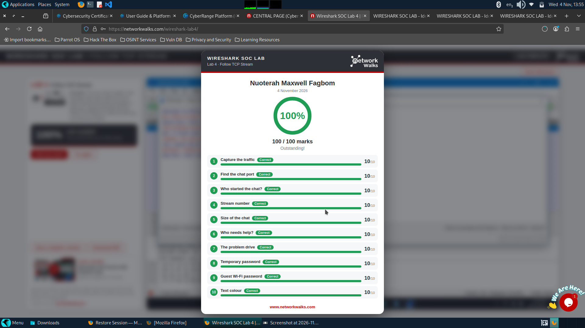
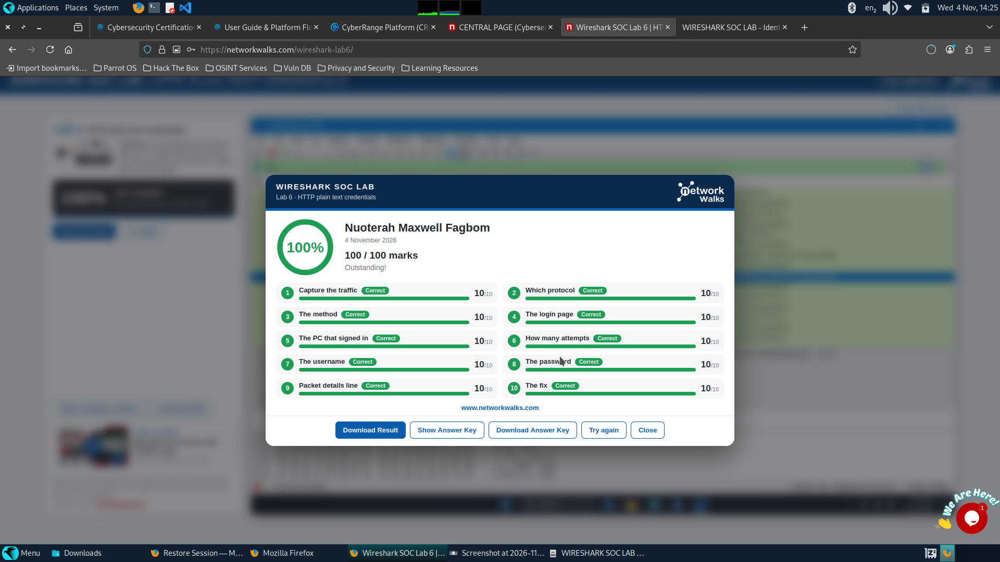

This file contains all screenshots of the wireshark project work completion given for this week.

The 1st Screenshot was based on finding an attackers IP in the traffic

The 2nd screenshot was based on following a TCP stream (Follow TCP Stream 1)

The 3rd screenshot was the same as before but seen in a different aspect (TCP Stream 2)

The 4th screenshot was for HTTP Plain text credentials exposure

The 5th screenshot  was for identifying a brute force attack

The6th Screenshot was for listen to a conversation between 2 people over VOIP. Mainly made use of SIP and RTP

